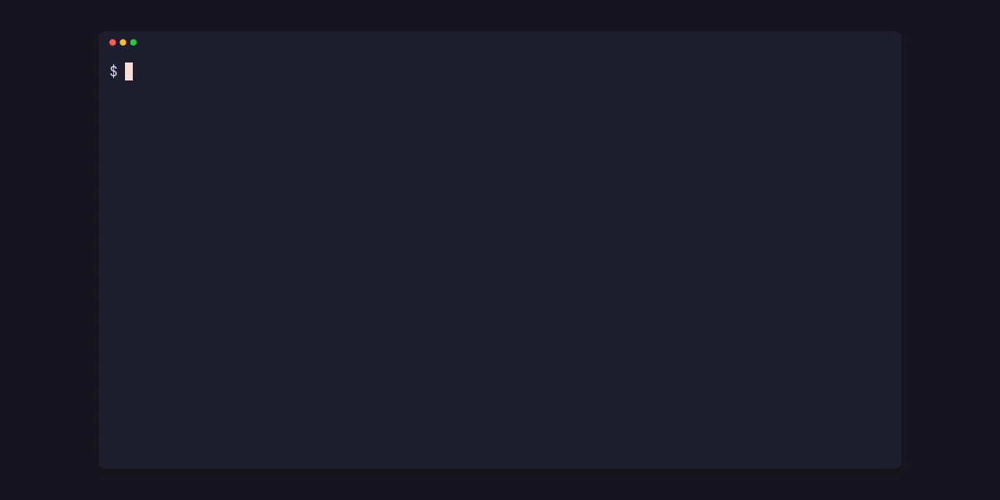
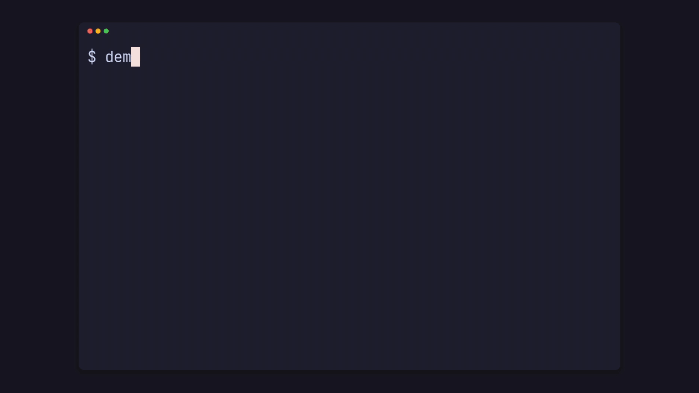
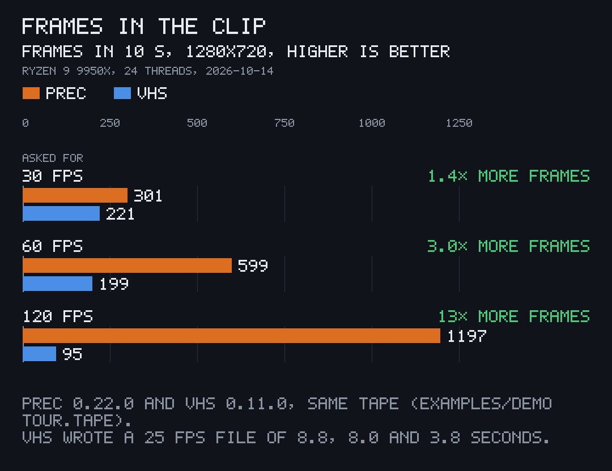
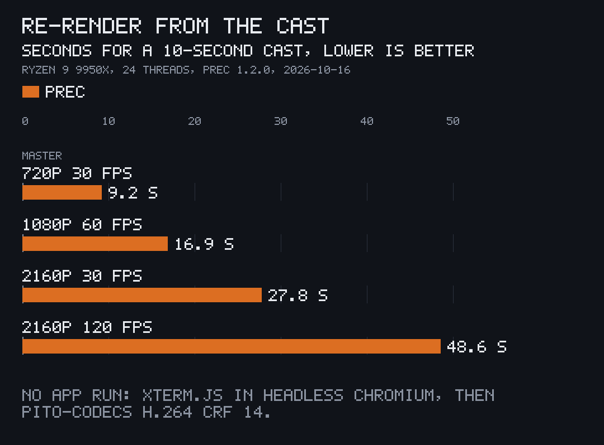
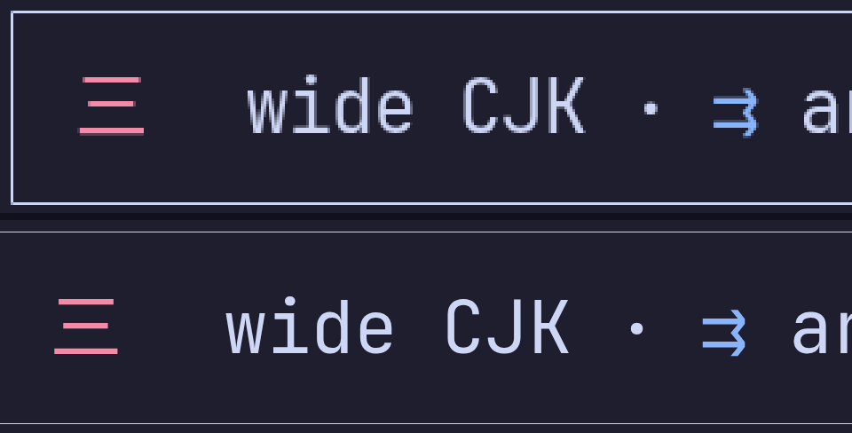
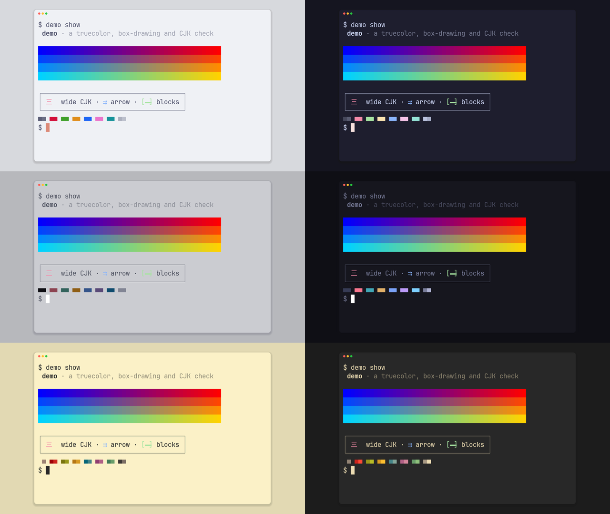
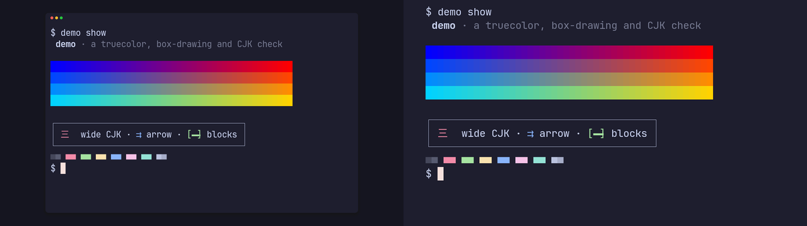

<p align="center"></p>

# prec

[](https://github.com/gmrdad82/prec/tags)

prec records terminal apps into exact videos and stills, part of [PITO MD](https://pitomd.com). It is an alternative to [VHS](https://github.com/charmbracelet/vhs): you write a tape of keystrokes, and prec runs your app in a real pty, records the session once, then replays it frame by frame in headless Chromium at exactly 24, 30, 48, 60 or 120 fps or the NTSC rates 23.976, 29.97, 47.952 and 59.94 (as exact rationals such as 24000/1001), at any size up to 4K. The same recording always replays to the same bytes.

| | |
|---|---|
| Frames in a 10-second clip at 120 fps | **1,196**, every one (VHS v0.11.0 on the same tape: 214) |
| Re-render a 10-second cast at 1080p 60 fps | **16.9 s**, without running the app again |
| Two renders of one cast | **byte-identical** masters, same sha256 |
| Sizes and rates | any size up to **3840x2160**, at **24, 30, 48, 60 or 120 fps**, or NTSC **24000/1001, 30000/1001, 48000/1001 and 60000/1001** |
| Binary | **5.7 MB**, stripped, fat LTO, its H.264 encoder built in (2.4 MB as the release `.tar.gz`) |
| Code | **10,912 lines** of Rust in `src/`, unit tests included; **18** direct dependencies |
| Cold release build | **70.4 s** with 4 build jobs |
| Network | none: prec downloads nothing |

Measured on 2026-10-16 on an AMD Ryzen 9 9950X (prec and VHS pinned to the same 24 threads), with prec 1.2.0 and VHS v0.11.0, from [docs/bench/bench.sh](docs/bench/bench.sh); see [Speed](#speed) for every number and how it was taken.

Got questions or doubts? Ping me on Discord: https://discord.gg/XsNcn3kYzn

## Start in 30 seconds

On Linux or WSL (macOS: swap `linux-x86_64` for `macos-arm64`), with Chromium installed ([Prerequisites](#prerequisites)):

```sh
v=$(basename "$(curl -fsSLo /dev/null -w '%{url_effective}' https://github.com/gmrdad82/prec/releases/latest)")
mkdir -p ~/.local/bin && curl -fsSL "https://github.com/gmrdad82/prec/releases/download/$v/prec-$v-linux-x86_64.tar.gz" | tar -xz -C ~/.local/bin prec
git clone https://github.com/gmrdad82/prec && cd prec
prec doctor
prec clip demo typing --app-dir examples/demo --size 720p --fps 30
```

That records this repository's sample app from its tape and writes `tmp/renders/demo/clip/demo-clip-typing-1280x720-30fps.master.mp4`, its poster PNG, the cast and a JSON manifest. Turn the master into a GIF with pcod from [pito-codecs](https://github.com/gmrdad82/pito-codecs) (`pcod <master> demo.gif --size 1280 --fps 15`): that is how the clip below was made.

<p align="center"></p>

## Features

### Every frame, at the rate you ask for

prec doesn't capture the screen while the app runs. It records the app's output bytes with their timestamps, then steps a virtual clock at exactly 1/fps (frame n sits at n × 1001/24000 s at 24000/1001, never a rounded float) and draws each frame, so a clip has the shown time times the fps in frames, however heavy the frame or the rate. Here is one 10-second tape recorded by both tools at 1280x720:

<p align="center"></p>

VHS v0.11.0 captured in real time and wrote a 25 fps file at every setting, shorter than the tape. prec's clips are 10.0 seconds at 30, 60 and 120 fps.

### Record once, render many

The session is kept as an [asciicast v2](docs/formats.md) cast. `prec render` replays a cast at another size, rate or theme without running the app again, and the same cast always gives the same bytes: in the benchmark, two 720p 30 fps renders of one cast wrote the same master, sha256 `4fab0be36a0ac519…`.

<p align="center"></p>

### Native pixels at every size

The grid is fixed and the font is fitted to each size, so 4K shows exactly what 720p shows, drawn at its own pixels rather than scaled. Top: a crop of a 1280x720 still, enlarged three times; bottom: the same crop of the 3840x2160 still from the same tape.

<p align="center"></p>

### 348 themes, light and dark from one recording

The app's own palette, any of VHS's 348 built-in schemes, curated light and dark pairs, and your installed [Omarchy](https://omarchy.org) themes. `--themes` renders one recording in several at once; these six came from one run of `prec still demo palette --themes "Catppuccin Latte,Catppuccin Mocha,TokyoNightLight,TokyoNight,Gruvbox Light,GruvboxDark"`.

<p align="center"></p>

### A window, or the app to the edges

`--frame window` draws a window with its bar and shadow on a ground; `--frame bare` leaves the app's own ground to the edges, for a TUI that fills its terminal.

<p align="center"></p>

### A real terminal

xterm.js 5.5 with Unicode 11 widths draws truecolor, box drawing, wide CJK and Nerd Font glyphs. Before the recording shows, prec types the shot's `launch` hidden and waits `settle`; a tape can `Wait /regex/` for the screen instead of guessing a sleep, or `Idle 3s` until the screen stops changing, as when an agent session finishes, and `Squeeze 400ms` shortens every stretch where only a spinner moves.

### Masters, not deliveries

A clip is one silent H.264 master (CRF 14, BT.709 limited range, tagged), encoded inside prec by [pito-codecs](https://github.com/gmrdad82/pito-codecs) with no ffmpeg, a poster PNG and a JSON manifest with each file's sha256. A still is a 16-bit sRGB master PNG with 8-bit PNG deliveries, extra sizes and `@2x` web copies. Turn a master into a GIF, WebP or a web MP4 with pcod from [pito-codecs](https://github.com/gmrdad82/pito-codecs) or ffmpeg.

### Your app, your repository

Each app keeps its own `render/terminal.toml` and tapes. prec builds the app (a cached build per commit), runs its fixture setup and teardown in a clean environment, and renders the working tree or any tag or commit with `--rev`.

## Speed

All numbers come from one run of [docs/bench/bench.sh](docs/bench/bench.sh) on 2026-10-16: an AMD Ryzen 9 9950X on Linux, both tools pinned to the same 24 threads (`CPUS=4-15,20-31`) at nice 10, prec 1.2.0 with `PREC_DIRECT=1` and VHS v0.11.0, recording [examples/demo](examples/demo)'s `tour.tape` (about 10 seconds of typing, progress bars and the palette) at 1280x720. The charts are drawn by [pito-compare](https://github.com/gmrdad82/pito-compare) from [docs/bench/](docs/bench).

| asked for | prec frames | prec clip | prec wall time | VHS frames | VHS file | VHS wall time |
|---|---|---|---|---|---|---|
| 30 fps | 299 | 30 fps, 9.97 s | 20.5 s | 239 | 25 fps, 9.56 s | 13.9 s |
| 60 fps | 598 | 60 fps, 9.97 s | 21.7 s | 228 | 25 fps, 9.12 s | 14.3 s |
| 120 fps | 1,196 | 120 fps, 9.97 s | 23.4 s | 214 | 25 fps, 8.56 s | 15.2 s |

VHS finishes sooner, because it keeps what it can capture in real time; prec records in real time, then replays and encodes every frame at CRF 14 with pito-codecs' H.264 encoder. A frame's moment that brings no new bytes reuses the previous frame, so a mostly still terminal replays faster than a busy one.

Re-rendering the 30 fps recording's cast, with no app run: 720p 30 fps in 9.2 s (299 frames; the same render again took 9.8 s and wrote the same bytes), 1080p 60 fps in 16.9 s (598 frames), 2160p 30 fps in 27.8 s (299 frames) and 2160p 120 fps in 48.6 s (1,196 frames).

Size and build: the Linux x86_64 binary is 5,935,688 bytes (5.7 MB; 2,508,494 bytes packed as the release's `.tar.gz`), built with fat LTO, one codegen unit and stripped; a cold `cargo build --release --locked` took 70.4 s with 4 build jobs. `src/` is 10,912 lines of Rust with its unit tests. prec has 18 direct dependencies and 95 crates in its Linux build; the xterm.js files, the VHS themes and pito-codecs' H.264 encoder are compiled in, so it runs no encoder of yours and reads nothing from the network. Renders on a Mac are untested.

## Install

prec runs on Linux (x86_64), on Windows through WSL, and on macOS (Apple Silicon). Each [release](https://github.com/gmrdad82/prec/releases/latest) carries a Linux and a macOS binary with a `SHA256SUMS` file. On macOS the binary is built on an Apple Silicon Mac; renders on a Mac are untested.

**Linux and WSL:**

```
v=$(basename "$(curl -fsSLo /dev/null -w '%{url_effective}' https://github.com/gmrdad82/prec/releases/latest)")
mkdir -p ~/.local/bin && curl -fsSL "https://github.com/gmrdad82/prec/releases/download/$v/prec-$v-linux-x86_64.tar.gz" | tar -xz -C ~/.local/bin prec
```

**macOS:**

```
v=$(basename "$(curl -fsSLo /dev/null -w '%{url_effective}' https://github.com/gmrdad82/prec/releases/latest)")
mkdir -p ~/.local/bin && curl -fsSL "https://github.com/gmrdad82/prec/releases/download/$v/prec-$v-macos-arm64.tar.gz" | tar -xz -C ~/.local/bin prec
```

`~/.local/bin` needs to be on your `PATH`.

**From source**, with Rust 1.97 or newer:

```
cargo install --locked --git https://github.com/gmrdad82/prec --tag vX.Y.Z prec
```

### Prerequisites

prec drives tools you install yourself:

- **Chromium** or Google Chrome, run headless (`chromium`, `chromium-browser`, `google-chrome-stable` or `google-chrome` on the `PATH`, or `chromium` in the config).
- **fontconfig** (`fc-match`, `fc-list`), the default font **JetBrainsMono Nerd Font** (or pass `--font`), and a CJK font for wide characters.
- **git** and **bash**.

On Debian or Ubuntu: `sudo apt install chromium fontconfig fonts-noto-cjk git`. On Arch: `sudo pacman -S chromium fontconfig noto-fonts-cjk ttf-jetbrains-mono-nerd git`. On macOS with Homebrew: `brew install fontconfig git` and `brew install --cask chromium font-jetbrains-mono-nerd-font`, then point `chromium` in the config at `/Applications/Chromium.app/Contents/MacOS/Chromium`. The JetBrainsMono Nerd Font is also at [nerdfonts.com](https://www.nerdfonts.com/font-downloads).

`prec doctor` checks all of it and says what is missing.

## Use

prec runs inside your app's git repository and reads `render/terminal.toml` at its top (or `--app-dir`). Everything it writes lands under that repository's `tmp/`.

```sh
prec shots myapp
prec clip  myapp tour --size 1080p --fps 60
prec still myapp palette --size 2160p --derive 1080p --web 800
prec clip  myapp tour --rev v1.4.0 --themes "Catppuccin Latte,Catppuccin Mocha"
prec render tmp/renders/myapp/clip/myapp-clip-tour-1920x1080-60fps.cast --size 720p --fps 30
```

Outputs land in `tmp/renders/<app>/{still,clip}/`, one `<stem>.json` manifest per render with its `<stem>.cast` beside it. A clip writes `<stem>.master.mp4` and `<stem>.poster.png`; a still writes `<stem>.master.png`, the 8-bit PNG and any derived sizes and web copies. [docs/formats.md](docs/formats.md) specifies the manifest, the cast and the cache reports. This repository's own sample app, `examples/demo`, is a working example:

```sh
prec clip demo typing --app-dir examples/demo --size 720p --fps 30
```

### render/terminal.toml

```toml
app = "myapp"
bin = "myapp"
grid = [120, 34]
frame = "bare"
setup = "{bin}/myapp-fixture >/dev/null"
teardown = "myapp server --stop || true"

[build]
command = "cargo build --release --locked --bin myapp --bin myapp-fixture"
bin_dir = "{target}/release"

[env]
MYAPP_DATA = "{scratch}/data"
MYAPP_NOW = "2026-09-29T10:00:00Z"

[theme]
background = "#eff1f5"
foreground = "#4c4f69"

[shots.tour]
kind = "clip"
line = "The terminal workspace stepping through its views"
tape = "render/terminal/tour.tape"
launch = "myapp tui"
settle = "3s"
closure = "palindrome"
```

The placeholders are `{tmp}` (the repository's `tmp/`), `{scratch}` (this run's scratch), `{app}` (the checkout), `{bin}` (the cached build of this commit), `{target}` (the repository's shared cargo target dir in the cache) and `{fixtures}`. They expand the same way in `setup`, `teardown`, `launch`, `cwd`, every `[env]` value and the `[build]` command, and `bin_dir` takes `{tmp}`, `{app}` and `{target}`. `bin_dir` alone, with no `command`, uses prebuilt binaries in the tree, and `--bin DIR` skips the build.

- **Environment.** The pty starts from a clean environment: `TZ=UTC`, `LANG=C.UTF-8`, `TERM=xterm-256color`, `COLORTERM=truecolor`, a scratch `HOME`, `USER`, `LOGNAME`, `[env]` as written, every `pass_env` variable, and `PATH=<bin>:<system PATH>`. `setup` runs before the recording and `teardown` after it, even when the recording fails or prec is cancelled.
- **No private data.** `pass_env = ["NAME", …]` hands each named variable from prec's own environment to the pty and the hooks; the cast and manifest list the names, never the values, and an unset name refuses the record. `home = "/home/<name>"` (Linux only) runs the session under `unshare` in a user, mount and UTS namespace with that absolute home (bound to the scratch `HOME`, `USER` and `LOGNAME` its last part), `hostname` (default `prec`) as its host, and every path of yours still reachable; `{home}` expands to it in `cwd` and `launch`, so `cwd = "{home}/work"` starts the shell there. Before a replay, `clip`, `still` and `render` read the screen the cast shows and refuse a picture with your home path, hostname, user name, an email, a passed value, or a plan or organisation label (`Claude Max`, `someone's Organization`) or a usage limit line (`You've used 77% of your weekly limit`, `session limit · resets 3pm`), one line per finding at its shown second; `record` keeps the cast and prints them as warnings.
- **Masks.** `mask = [{ match = "<regex>" }, { rect = [col, row, cols, rows] }]`, at the top of `terminal.toml` for every shot or in a shot for its own, fills each match on the screen, wherever and whenever it shows, and each block of cells with the theme's background in every frame. The masks are written into the cast, so every replay covers them, and the scan for private data reads the screen with them applied.
- **Inset.** `inset = "4%,15%,20%,4%"` (or `--set inset=…`) places the grid in a box inside the frame, for a video's safe zone (YouTube Shorts keeps text from 4% in on the left and top to 85% across and 80% down). Like CSS padding it takes one to four sides, top, right, bottom, left, each in `%` of the frame's height (top, bottom) or width (left, right), or in pixels at the master size (`40` or `40px`). The grid is scaled to fit the box and centred in it; `--frame bare` fills the rest with the terminal's own background and `--frame window` sets the window in the box on its ground. Clips, frames from `--no-encode` and stills take it alike, and it is written into the cast, so `prec render` keeps it unless `--set inset=…` changes it.
- **Launch.** `launch` is typed hidden, then prec waits `settle` before the recording shows.
- **Tapes** hold only steps: `Type[@speed] "…"`, `Enter`, `Backspace`, `Delete`, `Tab`, `Shift+Tab`, `Escape`, `Space`, `Up`/`Down`/`Left`/`Right`, `Home`/`End`, `PageUp`/`PageDown`, `Ctrl+<key>`, `Alt+<key>`, each with an optional `@speed` and repeat count, plus `Sleep`, `Hide`, `Show`, `Screenshot`, `Wait[+Screen][@timeout] /regex/`, `Wait+Exit[@timeout]`, `Idle[@timeout] [duration]`, `Squeeze [gap] [/regex/]` or `Squeeze off`, and `Resize <cols>x<rows> [duration]`. `Wait` matches the last non-blank row of the screen, `Wait+Screen` the whole screen, and `Wait+Exit` waits until the session's shell has exited and its terminal has closed (after an `exit`, or after an app started with `exec` quits), its last output kept; `Idle 3s` waits until the screen, colours and cursor included, has not changed for 3 seconds (default 2 s, timeout 5 minutes); a timeout prints the rows it saw, and a regex sees a no-break space as a space. `Squeeze 400ms` cuts every later stretch where no letter on the screen changes (a spinner, a counter) to 400 ms, keeping typed and printed text and `Sleep` at real speed; its `/regex/` names status rows to leave out. `Resize 38x16 3s` resizes the pty one column and row at a time on an ease-in-out curve over 3 seconds (without a duration, at once); the app gets each new size as it would from a dragged window, the cast keeps each size as an asciicast `r` event, and the render keeps the text size and the output size while the window's right and bottom edges follow the grid. A tape that opens with `Hide` shows nothing before its first `Show`. The settings live in `terminal.toml`, so a tape that sets `Output`, `Set`, `Require`, `Env` or `Source` is refused. A still is taken at the tape's last `Screenshot`.
- **Closure.** `closure = "palindrome"` plays the clip forward then back, `closure = { crossfade = 0.5 }` blends its end into its start, and no closure leaves an open clip.
- **Poster.** `poster` is `"first"` (the default), `"before-closure"` (the last frame shown in full before the closure) or a number of seconds; `--poster` overrides it for one render.
- **Cancel.** TERM, INT and HUP stop everything prec started, process groups and all, run `teardown`, and exit 128 plus the signal. Recording one shot is exclusive in a tree; replays of it at different sizes, rates or themes run at once.

### Commands

| command | what it does |
|---|---|
| `shots <app>` | lists the shots in `render/terminal.toml` |
| `clip <app> <shot>` | records and writes the H.264 master, its poster and the manifest |
| `still <app> <shot>` | records and writes the 16-bit master PNG with 8-bit PNG deliveries |
| `record <app> <shot>` | records only, into an asciicast v2 cast |
| `render <cast>` | replays a cast at a chosen size, fps and theme |
| `themes [--all]` | the curated pairs, your installed Omarchy themes, and with `--all` every built-in scheme |
| `doctor` | checks Chromium, the fonts, git, the config, the cache and the archive, and names the built-in encoder |
| `cache [--json]` | the machine cache: where it is, its size, and every entry with its size and last use |
| `cache prune [--older-than 30d] [--all] [--json] [--dry-run]` | removes entries unused for 30 days (or `--older-than`), or all of them; entries in use stay |
| `archive --retry`, `archive --reindex` | retries queued archive copies, or rebuilds the archive's catalog (see Archive) |

Flags for `clip`, `still` and `record`:

| flag | meaning |
|---|---|
| `--app-dir DIR` | the app's folder in this repository; default the repository's top |
| `--rev R` | a tag or commit to build and render, read from git without touching the index or tree |
| `--bin DIR` | a prebuilt folder holding the app's binary; skips the build |
| `--size` | the largest delivery: `N` (square), `WxH` (even for clips), `720p`, `1080p`, `1440p` or `2160p` |
| `--derive` | more still sizes from the same master |
| `--fps` | `24`, `30`, `48`, `60` or `120` (the default) for a clip, or an NTSC rate as its exact rational, `24000/1001`, `30000/1001`, `48000/1001` or `60000/1001`, or as `23.976` (or `23.98`), `29.97`, `47.952` (or `47.95`) or `59.94`; another decimal is refused with the rational to use |
| `--poster` | a clip's poster: `first`, `before-closure` or seconds of shown time |
| `--web` | still web copies at these widths, each also at `@2x`, resampled in linear light |
| `--theme` | `app` (the default: the app's `[theme]`, else the config's theme, else `Catppuccin Mocha`), any built-in scheme, or `omarchy:<name>` |
| `--themes` | one render per theme from one recording, e.g. `"Catppuccin Latte,Catppuccin Mocha"` |
| `--font` | the font family; default JetBrainsMono Nerd Font |
| `--frame` | `window` (a window on a ground) or `bare` (the app's own ground to the edges) |
| `--fixtures DIR` | a fixture folder, passed to the app as `{fixtures}` and in the env var the recipe's `fixtures_env` names (default `PITO_<APP>_FIXTURES`) |
| `--set key=value` | `grid=120x34`, `typing=40ms`, `settle=2s`, `closure=palindrome`, `closure=none`, `closure.crossfade=0.5`, `launch=…`, `ground=#rrggbb`, `inset=4%,15%,20%,4%` |
| `--out`, `--seed` | the output folder (default `tmp/renders`) and the seed |
| `--keep-frames` | keep the raw frames under `tmp/prec/run/` until the next run of that shot |
| `--no-encode` | write a clip's frames only, with no master |
| `--no-archive` | never archive this render |
| `--allow-private` | skip the scan for private data in the picture, for a render that stays private; the manifest records `"private_allowed": true` |

`render <cast>` takes the delivery flags (`--size`, `--derive`, `--fps`, `--poster`, `--web`, `--theme`, `--themes`, `--font`, `--frame`, `--set closure…|ground=…`, `--out`, `--keep-frames`, `--no-encode`, `--no-archive`, `--allow-private`); the grid and the session come from the cast.

Input prec can't parse gets clap's short answer on stderr with exit 2; `--help` prints the full help. Refusals after parsing are one line, `prec: …`, with exit 1.

## Themes

| family | light | dark |
|---|---|---|
| Catppuccin | `Catppuccin Latte` | `Catppuccin Mocha` |
| Tokyo Night | `TokyoNightLight` | `TokyoNight` |
| Gruvbox | `Gruvbox Light` | `GruvboxDark` |
| Solarized | `Builtin Solarized Light` | `Builtin Solarized Dark` |
| GitHub | `Github` | `GitHub Dark` |
| One Half | `OneHalfLight` | `OneHalfDark` |
| Nord | `nord-light` | `nord` |

`Rose Pine`, `Dracula` and `Kanagawa` are there too, among 348 schemes: VHS v0.11.0's built-in set, vendored in `assets/vhs-themes.json` (VHS itself isn't needed). On [Omarchy](https://omarchy.org), every installed theme is `omarchy:<name>`, read at run time from `/usr/share/omarchy/themes`, `$OMARCHY_PATH/themes`, `~/.local/share/omarchy/themes` and `~/.config/omarchy/themes` (its `colors.toml`, else its `kitty.conf`).

## Configuration

prec works with no configuration. An optional `config.toml` lives at `${XDG_CONFIG_HOME:-~/.config}/prec/config.toml`, or wherever `PREC_CONFIG` points; `prec doctor` shows which file it read. An unknown key is refused.

```toml
theme = "TokyoNight"
chromium = "/opt/chromium/chrome"
archive = "~/Renders"

[confine]
slice = "build.slice"
cpus = "4-15"
```

| key | default | meaning |
|---|---|---|
| `theme` | `Catppuccin Mocha` | the theme for an app whose `terminal.toml` has no `[theme]` |
| `chromium` | found on the `PATH` | the Chromium or Chrome binary (`PREC_CHROMIUM` overrides it) |
| `archive` | none | an archive root; without one nothing is archived (`PITO_ARCHIVE` overrides it) |
| `[confine]` | absent | on Linux with systemd, run Chromium in a memory-capped `systemd-run --user` scope at nice 10, and prec's own encode at nice 10 |
| `[confine] slice` | `build.slice` | the systemd slice for those scopes |
| `[confine] cpus` | unpinned | pin Chromium (with `taskset -c`) and the encode to this CPU list |
| `[confine] cpus_from`, `cpus_key` | | or read the CPU list from a shell env file's key (`cpus_key`, default `BUILD_CPUS`) |

Other environment variables: `PREC_CACHE` moves the machine cache, `PREC_DIRECT=1` runs everything unconfined and never archives (for tests), and `PITO_JOBS=off` turns off the live job record (below).

## The machine cache

Everything reusable lives in one cache, shared by every repository: `${XDG_CACHE_HOME:-~/.cache}/prec/`, or `PREC_CACHE`. Outputs and scratch stay in each repository's `tmp/`.

| folder | holds | keyed by |
|---|---|---|
| `src/<repo>/<commit>/` | that commit's source, checked out by `git read-tree` with a private index, read-only (`{app}`) | repo and commit |
| `work/<repo>/` | the build tree, moved between commits so only changed files change | repo |
| `target/<repo>/` | the repo's shared cargo target dir, so a new commit rebuilds incrementally | repo |
| `bin/<repo>/<commit>-<build>/` | the built binaries (`{bin}`) | repo, commit and the build command's hash |
| `locks/` | one lock per entry, so a prune never removes an entry being built or used | |
| `archive-queue/` | renders waiting for an archive that was offline | |

A `<repo>` key is the repository's name and a hash of its origin URL, so every checkout and worktree of one repository shares entries. A dirty working tree builds incrementally in the shared target dir and is never stored as a commit. prec downloads nothing.

## How it renders

- **Record.** The app runs in a pty of exactly the grid, driven by the tape at real speed. Its output bytes are kept with monotonic timestamps as an asciicast v2 cast, with the input events and `hide`, `show`, `screenshot` and `end` markers.
- **Replay.** A vendored xterm.js 5.5.0 (canvas renderer, Unicode 11 widths) runs in headless Chromium (`--disable-gpu`, sRGB), started through `env -i` with a scratch `HOME`, `TZ=UTC` and `C.UTF-8`, so your locale and fontconfig never reach it. prec steps a virtual clock at exactly 1/fps (frame n sits at n × 1001/24000 s at 24000/1001, never a rounded float), writes every cast byte up to that moment, waits for xterm to paint and screenshots the page at the target size. Hidden stretches are cut; a frame whose moment brings no new bytes reuses the previous one.
- **Encode.** A clip is one silent H.264 High master at the render's size and fps, encoded inside prec by pito-codecs 1.16.3 with no ffmpeg: its `quality` preset, CRF 14, no B-frames, 8-bit 4:2:0, a keyframe every two seconds, BT.709 limited range tagged in the stream. Chromium's 8-bit frames go to YUV with the BT.709 limited-range matrix and left-sited chroma; a crossfade is blended from the two frames before that. The encoder's 16 threads are fixed, because its output follows its thread count; that keeps a master byte-identical on any machine. prec reads the MP4 back and checks its frame count and size before the manifest claims them.
- **Atomic.** A render builds its files in its scratch folder, then moves them into the output folder and writes the manifest last, so a failed or cancelled re-render never leaves new files beside an old manifest.

## Archive

An archive is optional and off unless `archive` (or `PITO_ARCHIVE`) names a root. Then a render of a pinned, committed revision (`--rev <tag or commit>`) is copied to `<root>/Masters/prec/<app>/<shot>/<YYYY-MM-DD>_<HHMMSS>_<version>_<caller>/`, with every file it wrote and its `manifest.json`, and one line is appended to `<root>/Masters/catalog.jsonl`, the catalog it shares with [pfx](https://github.com/gmrdad82/pfx)'s renders. A working-tree render, a `--bin` build, a dirty revision, `--no-encode`, `--no-archive` and the `demo` sample are never archived, and the manifest records why. A leaf is built as `<leaf>.partial/`, each file hashed as it is copied and checked against the manifest, then renamed into place. When the root is offline, the render still succeeds, waits in the cache's `archive-queue/`, and goes with the next render or `prec archive --retry`. `prec archive --reindex` rebuilds the catalog from the line each leaf's `manifest.json` stored when it was archived; it reads no other file in the leaf.

## Job records

Every `clip`, `still`, `record` and `render` publishes a live job record, in RAM only, in `$XDG_RUNTIME_DIR/pito-jobs/` (or `PITO_JOBS_DIR`; on macOS without `XDG_RUNTIME_DIR`, `$TMPDIR/pito-jobs/`), with its stages (`build`, `record`, `replay`, `master` or `derive`, `archive`) and progress, for a dashboard to show. prec writes the record itself, in the job-record format of pito-jobs v1.0.3: one JSON file per render, `<pid>-<started ms>.json`, rewritten atomically, at most once a second for progress, and at most 4 KiB. It reads `PITO_JOB_ID` as its parent job, `PITO_INVOKER` as its invoker and `GPU_QUEUE_PID` as its GPU queue. With neither `PITO_JOBS_DIR` nor `XDG_RUNTIME_DIR` (nor `TMPDIR` on macOS) there is none, `PITO_JOBS=off` turns it off, and a record that can't be written never fails the render.

## Part of PITO MD

prec is one of the open tools of [PITO MD](https://pitomd.com), made for its apps and games and free for yours. It is the terminal half of the renders: [pfx](https://github.com/gmrdad82/pfx) and Manfred render the 3D and app scenes, prec renders the TUIs and CLIs. pcod from [pito-codecs](https://github.com/gmrdad82/pito-codecs) turns prec's masters into GIFs, WebP and web MP4s, and [pito-compare](https://github.com/gmrdad82/pito-compare) draws the charts on this page. prec writes its own live job records.

## Contributing

Issues are welcome at [github.com/gmrdad82/prec/issues](https://github.com/gmrdad82/prec/issues): a bug with the command line, your `terminal.toml` and tape, and what `prec doctor` says, or an idea for something prec should record. Pull requests aren't taken. Please read the [code of conduct](CODE_OF_CONDUCT.md) first, and report a security issue privately as [SECURITY.md](SECURITY.md) says.

## Build and test

```
cargo build --release
bin/gate
bin/gate --fast
bin/gate --render
```

`bin/gate` runs ShellCheck (when it is installed), rustfmt, clippy with warnings as errors, and the unit tests with cargo test. `bin/gate --fast` runs the same checks with cargo-nextest when it is installed (cargo test otherwise) and ends with `fast gate: green`, the line a change must reach before it merges. `bin/gate --render` runs the integration tests, which drive the prec binary through Chromium on Linux, and decode its masters in-process with pito-codecs to check them, with no ffmpeg (they need the prerequisites above and a systemd user session for the confinement tests). Each release carries the Linux and macOS binaries and the docs bundle, `docs-vX.Y.Z.tar.gz`, which `bin/docs-bundle` makes from `docs/site/`, the binary's `--help`, `docs/formats.md` and `CHANGELOG.md`. The README's GIFs are prec's own shot in `render/terminal.toml` and the clip it records, made GIFs by pcod; its stills are prec renders of `examples/demo`'s palette, laid side by side with ImageMagick, and its charts are pito-compare's from `docs/bench/` ([NOTICE](NOTICE)).

## Licence


The code is MIT licensed ([LICENSE](LICENSE)), © Catalin Ilinca. The prec and PITO MD names and their logos are © Catalin Ilinca, all rights reserved, and are not covered by the MIT licence ([TRADEMARKS.md](TRADEMARKS.md)). The vendored xterm.js and VHS themes keep their own MIT licences ([NOTICE](NOTICE)).
